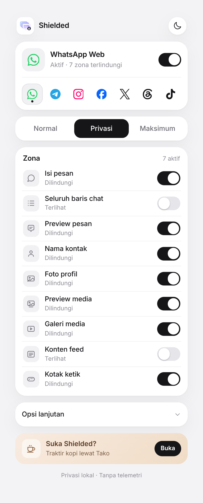
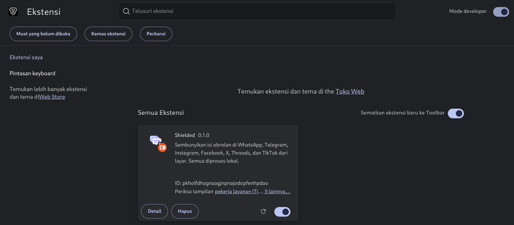
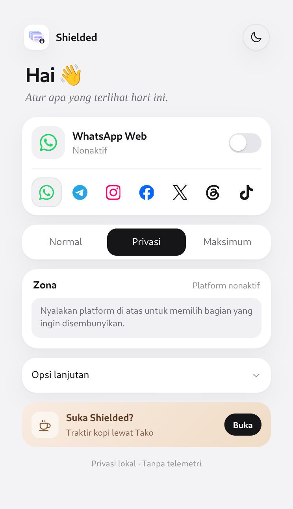
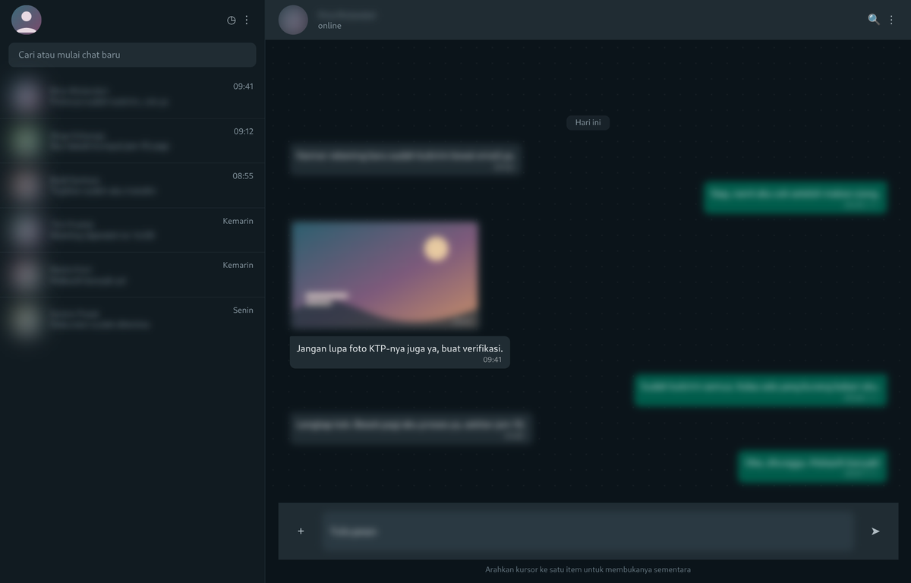

# Shielded

**Privasi visual untuk web chat.** Sembunyikan nama, foto profil, preview pesan, isi percakapan, media, dan kotak ketik dari layar — lalu buka satu per satu saat Anda benar-benar perlu melihatnya.

> [!IMPORTANT]
> **Jangan pakai tombol `Code` → `Download ZIP` untuk memasang.** Itu arsip kode sumber: tidak ada `manifest.json` di akarnya (yang ada `manifest.config.ts`) dan belum ada hasil build, jadi Chrome menolak dengan pesan **"Tidak dapat memuat manifes"**.
>
> Unduh paket siap pasang dari **[Releases](https://github.com/Zwart04/Shielded/releases/latest)**: `shielded-<versi>-chromium.zip` untuk Chrome/Edge/Brave/Opera/Vivaldi, atau `shielded-<versi>-firefox.zip` untuk Firefox. Keduanya sudah berisi `manifest.json` + seluruh berkas build.

[](https://github.com/Zwart04/Shielded/releases/latest)


[](LICENSE)

Shielded bekerja **per item**, bukan memblur seluruh halaman. Nama kontak, avatar, preview, gelembung pesan, dan kotak ketik masing-masing bisa diatur. Saat kursor diarahkan ke satu item, hanya item itu yang terbuka — sisanya tetap terlindungi.

Semua pemrosesan terjadi di perangkat Anda. Tidak ada server, akun, atau telemetri.

<a href="https://tako.id/Zwart04/gift"></a>

<br>



> **Bawaan: semua platform nonaktif.** Shielded tidak menyentuh halaman apa pun sampai Anda menyalakannya. Setelan, level, dan pilihan zona semuanya ada di popup — tidak ada halaman pengaturan kedua.

---

## Daftar Isi

- [Fitur](#fitur)
- [Platform yang Didukung](#platform-yang-didukung)
- [Instalasi](#instalasi)
- [Tutorial Pemakaian](#tutorial-pemakaian)
- [Zona Perlindungan](#zona-perlindungan)
- [Level Perlindungan](#level-perlindungan)
- [Pintasan Keyboard](#pintasan-keyboard)
- [Dukung Pengembangan](#dukung-pengembangan)
- [Batas Perlindungan](#batas-perlindungan)
- [Privasi dan Izin](#privasi-dan-izin)
- [Pengembangan](#pengembangan)
- [Status Verifikasi](#status-verifikasi)
- [Dokumentasi](#dokumentasi)
- [Lisensi](#lisensi)

---

## Fitur

- **Satu panel, tanpa halaman kedua** — semua kontrol ada di popup: pilih platform, nyalakan proteksi, atur level, dan tentukan zona.
- **Nonaktif secara bawaan** — pemasangan baru tidak mengubah tampilan situs sampai Anda menyalakan sebuah platform.
- **Proteksi per item** — 9 zona independen: isi pesan, baris chat, preview, nama, avatar, preview media, galeri media, konten feed, dan kotak ketik.
- **Hover membuka satu item** — item lain di sekitarnya tetap kabur. Bisa dimatikan di opsi lanjutan.
- **Hanya ruang pesan** — zona percakapan hanya aktif di route DM: Instagram & Threads `/direct/*`, Facebook `/messages/*` + messenger.com, X `/messages/*`. Beranda, profil, reels, dan pencarian tidak pernah tersentuh; di sana hanya zona **Konten feed** yang bisa menyala.
- **Panel pesan mengambang ikut terlindungi** — jendela Chats Facebook dan panel DM X yang dibuka dari beranda diproses hanya di dalam panelnya, jadi feed di sekelilingnya tetap terlihat.
- **Pengaturan per platform** — aktifkan proteksi hanya di platform yang Anda pakai, lalu atur zonanya sendiri.
- **Tiga level siap pakai** — Normal, Privasi, Maksimum. Berlaku langsung tanpa reload.
- **Ringan** — deteksi ber-throttle 120 ms, pemrosesan idempoten, animasi 120 ms. Tidak ada pemindaian teks pesan.
- **Local-first** — preferensi disimpan di `chrome.storage.local`; nol permintaan jaringan.

---

## Platform yang Didukung

| Platform | Alamat | Status verifikasi live |
|---|---|---|
| WhatsApp Web | `web.whatsapp.com` | Lolos |
| Telegram Web | `web.telegram.org` | Lolos |
| Instagram (feed + DM) | `www.instagram.com` | Lolos |
| Facebook (feed + Messenger) | `www.facebook.com` | Lolos |
| X / Twitter | `x.com`, `twitter.com` | Sebagian (login wall) |
| Threads | `www.threads.net`, `www.threads.com` | Lolos |
| TikTok (pesan) | `www.tiktok.com` | Lolos |

Verifikasi dilakukan 2026-11-10 pada Brave Origin 157 dengan profil uji. X belum bisa diuji penuh karena halaman DM meminta login; selector-nya tetap terpasang dan akan diverifikasi ulang saat tersedia akses.

Perubahan 0.1.3–0.1.7 (gating khusus route DM, panel Chats Facebook, isi percakapan Threads, prioritas item di layar) diverifikasi pada **DOM sintetis** di browser yang sama, bukan akun platform asli. Detail per uji ada di [Hasil Verifikasi Selector](docs/selector-verification-results.md).

---

## Instalasi

Shielded belum dipublikasikan di Chrome Web Store atau addons.mozilla.org. Ekstensi dimuat sebagai **unpacked** (Chromium) atau **temporary add-on** (Firefox).

Arsip **`Code` → `Download ZIP`** dari halaman repo adalah kode sumber, bukan paket pasang. Paket yang bisa langsung dimuat hanya ada di halaman **Releases**.

### Kompatibilitas browser

| Browser | Paket | Status |
|---|---|---|
| Chrome 110+ | `shielded-<versi>-chromium.zip` | Didukung |
| Edge 110+ | `shielded-<versi>-chromium.zip` | Didukung (mesin Chromium yang sama) |
| Brave, Opera, Vivaldi | `shielded-<versi>-chromium.zip` | Didukung |
| Firefox 140+ | `shielded-<versi>-firefox.zip` | Didukung (manifest lolos `web-ext lint`, add-on terpasang di Firefox 161) |
| Safari (macOS/iOS) | — | Belum didukung; perlu konversi lewat Xcode |
| Firefox for Android | — | Tidak ditargetkan |

### Chromium — Chrome, Edge, Brave, Opera, Vivaldi

1. Unduh `shielded-<versi>-chromium.zip` dari [halaman Releases](https://github.com/Zwart04/Shielded/releases/latest).
2. Ekstrak zip. Akan muncul satu folder, misalnya `shielded-0.1.17-chromium`.
3. Buka halaman ekstensi: `chrome://extensions`, `edge://extensions`, `brave://extensions`, `opera://extensions`, atau `vivaldi://extensions`.
4. Nyalakan **Mode developer** / **Developer mode** di kanan atas.
5. Klik **Muat yang belum dikemas** / **Load unpacked**, lalu pilih **folder hasil ekstrak** — folder yang berisi `manifest.json`.



6. Sematkan ikon Shielded ke toolbar agar popup mudah dibuka.

> **Jika muncul “Tidak dapat memuat manifes”:** browser tidak menemukan `manifest.json` tepat di folder yang dipilih. Jangan pilih file `.zip`, dan jangan pilih folder induknya. Pilih folder `shielded-<versi>-chromium` yang isinya langsung `manifest.json`, `background.js`, dan `content.js`.

### Firefox 140+

1. Unduh `shielded-<versi>-firefox.zip`, lalu ekstrak.
2. Buka `about:debugging#/runtime/this-firefox`.
3. Klik **Muat Add-on Sementara** / **Load Temporary Add-on**.
4. Pilih berkas `manifest.json` **di dalam** folder `shielded-<versi>-firefox`.
5. Ekstensi aktif sampai Firefox ditutup. Pemasangan permanen di Firefox memerlukan tanda tangan Mozilla (AMO), karena Firefox menolak add-on tidak bertanda tangan.

Firefox MV3 meminta izin situs secara *opt-in*. Bila popup bisa dibuka tetapi blur tidak muncul, buka `about:addons` → **Shielded** → tab **Izin/Permissions** → aktifkan akses untuk WhatsApp Web, Telegram Web, Instagram, Facebook, X, Threads, dan TikTok. Setelah izin diberikan, cukup muat ulang tab platformnya.

### Cara 2 — dari kode sumber

```bash
git clone https://github.com/Zwart04/Shielded.git
cd Shielded
npm install

npm run build          # Chromium  -> dist/
npm run build:firefox  # Firefox   -> dist-firefox/
```

Lalu pada langkah 5 di atas, pilih folder **`dist/`** (Chromium) atau `dist-firefox/` (Firefox). Setelah mengubah kode, jalankan build lagi dan klik **Muat ulang** pada kartu Shielded.

> Folder `dist/` dan `dist-firefox/` adalah hasil build. Jangan memilih folder akar proyek — folder itu tidak berisi `manifest.json`.

### Memperbarui ekstensi

Popup menampilkan versi yang terpasang di baris paling bawah, misalnya `v0.1.17 · Cek update`. Klik tautan itu untuk membuka [halaman rilis GitHub](https://github.com/Zwart04/Shielded/releases/latest); versi terbaru selalu ada di paling atas.

Chrome tidak mengizinkan ekstensi *unpacked* memperbarui dirinya sendiri, jadi pembaruan tetap dua langkah manual:

1. Unduh paket browser yang sama (`-chromium` atau `-firefox`) versi terbaru, lalu ekstrak **menimpa folder lama** (bukan folder baru).
2. Buka halaman ekstensi, klik **Muat ulang** pada kartu Shielded (Firefox: muat ulang lewat `about:debugging`).

Preferensi tidak hilang: ID ekstensi Chromium diturunkan dari lokasi folder, jadi selama foldernya sama, setelan Anda tetap terbaca. Ekstensi tidak memeriksa versi sendiri dan tidak mengirim permintaan jaringan apa pun; tautan update hanya membuka tab browser biasa.

---

## Tutorial Pemakaian

### 1. Buka popup

Klik ikon Shielded di toolbar. Saat pertama dipasang, semua platform **nonaktif** dan tidak ada yang berubah di halaman mana pun:



### 2. Pilih platform dan nyalakan

Deretan logo di kartu atas adalah pemilih platform. Logo dengan latar terang adalah platform yang sedang dibuka; titik kecil di bawah logo menandakan platform yang sudah aktif.

1. Ketuk logo platform yang ingin diatur.
2. Nyalakan sakelar di sebelah nama platform.
3. Daftar zona langsung muncul dan proteksi langsung berlaku di tab platform tersebut.


### 3. Atur level dan zona

- **Normal** — tidak ada yang disembunyikan.
- **Privasi** — pesan, preview, nama, avatar, media, dan kotak ketik dikaburkan.
- **Maksimum** — pesan, preview, dan media ditutup; nama dan avatar disembunyikan.

Level berlaku untuk semua platform, tetapi status aktif/nonaktif tiap platform tetap dipertahankan. Setelah memilih level, Anda masih bisa menyalakan atau mematikan zona satu per satu.

### 4. Opsi lanjutan

Buka **Opsi lanjutan** di bagian bawah popup:

- **Kekuatan blur** — Ringan, Sedang, atau Kuat untuk semua platform.
- **Hover membuka item** — matikan bila ingin semua tetap tertutup sampai pintasan ditekan.
- **Pintasan keyboard** — membuka `chrome://extensions/shortcuts` untuk mengubah kombinasi tombol.
- **Kebijakan privasi** — ringkasan data dan izin.

### 5. Pahami cara kerjanya

Halaman tetap terlihat normal, tetapi setiap item terlindungi sendiri-sendiri:


Arahkan kursor ke satu item — hanya item itu yang terbuka:



> Dua gambar di atas memakai percakapan contoh (DOM sintetis) agar tidak menampilkan data pribadi siapa pun. Tampilan asli tetap memakai antarmuka platform masing-masing.

---

## Zona Perlindungan

| Zona | Yang disembunyikan | Catatan |
|---|---|---|
| **Isi pesan** | Panel percakapan yang sedang dibuka | Gelembung pesan per item |
| **Seluruh baris chat** | Seluruh baris di daftar chat | Menutup nama, avatar, dan preview sekaligus |
| **Preview pesan** | Teks pesan terakhir di daftar chat | Tetap bisa dibaca setelah baris dibuka |
| **Nama kontak** | Nama di daftar chat dan header | Hover hanya membuka nama yang disorot |
| **Foto profil** | Avatar di daftar dan header | Blur lebih kuat karena area gambar |
| **Preview media** | Gambar dan dokumen kecil di daftar chat | |
| **Galeri media** | Gambar, video, dan dokumen di percakapan | |
| **Konten feed** | Teks dan media unggahan di feed | Satu-satunya zona yang aktif di luar route DM |
| **Kotak ketik** | Teks yang sedang diketik | Berguna saat berbagi layar |

Zona yang saling bertumpuk tidak digandakan: elemen di dalam item yang sudah terlindungi tidak diproses ulang, sehingga blur tidak menumpuk dan halaman tetap ringan.

---

## Level Perlindungan

| Level | Perilaku |
|---|---|
| **Normal** | Tidak ada yang disembunyikan. |
| **Privasi** | Pesan, preview, nama, avatar, preview media, galeri media, dan kotak ketik dikaburkan. |
| **Maksimum** | Pesan, preview, dan media ditutup; nama dan avatar disembunyikan. Tampilkan lewat hover atau pintasan. |

Preset bisa diubah per zona setelah diterapkan. Pilihan level disimpan bersama preferensi lain di perangkat.

---

## Pintasan Keyboard

| Pintasan | Fungsi | Bisa diubah |
|---|---|---|
| `Alt+Shift+S` | Aktifkan / nonaktifkan perlindungan | `chrome://extensions/shortcuts` |
| `Alt+Shift+R` | Tampilkan semua zona sementara | `chrome://extensions/shortcuts` |
| — | Sembunyikan semua zona segera (panic) | Tetapkan sendiri di `chrome://extensions/shortcuts` |

Chrome tidak mengizinkan ekstensi memetakan ulang pintasan secara programatik. Gunakan halaman pintasan bawaan browser untuk menyesuaikannya.

---

## Dukung Pengembangan

Shielded gratis, tanpa iklan, dan tanpa telemetri. Jika ekstensi ini membantu, Anda bisa mentraktir kopi lewat Tako:

<a href="https://tako.id/Zwart04/gift"></a>

Atau buka langsung: [tako.id/Zwart04/gift](https://tako.id/Zwart04/gift).

Dukungan bersifat opsional dan tidak membuka fitur tambahan. Tautan juga tersedia sebagai kartu di bagian bawah popup.

---

## Batas Perlindungan

Shielded adalah **proteksi tampilan visual**, bukan enkripsi. Yang perlu diketahui:

- Tidak melindungi dari **tangkapan layar**, **perekaman layar**, atau **berbagi layar** saat item sedang terbuka.
- Tidak melindungi dari **DevTools**, **pembaca layar**, atau siapa pun yang memegang perangkat Anda.
- Tidak mengubah data di server platform. Pesan tetap tersimpan di layanan masing-masing.
- Hover dan pintasan sengaja membuka item; jangan mengarahkan kursor ke layar yang sedang dibagikan.
- Perubahan DOM platform dapat membuat selector meleset. Perbaikan selector adalah pekerjaan berkelanjutan; lihat [Runbook Selector](docs/selectors-runbook.md).
- Proteksi gagal secara aman: bila selector tidak ditemukan, halaman tetap berjalan normal tanpa diblur.

---

## Privasi dan Izin

| Izin | Alasan |
|---|---|
| `storage` | Menyimpan preferensi secara lokal di perangkat |
| `scripting` | Menyuntikkan `content.js` sendiri ke tab platform yang sudah terbuka saat ekstensi baru dipasang/di-reload, supaya tidak perlu refresh halaman |
| Host permission 19 pola URL untuk 7 platform | Menjalankan content script visual hanya di domain platform yang didukung |
| `commands` | Mendaftarkan pintasan keyboard |

Yang **tidak** diminta: `<all_urls>`, `tabs`, `webRequest`, atau akses jaringan apa pun. `scripting` hanya menyuntik berkas milik ekstensi sendiri; tidak ada skrip dari jaringan.

- Tidak ada analitik, ikon pelacak, atau panggilan ke server.
- Preferensi tidak disinkronkan ke cloud.
- Content script hanya membaca struktur DOM untuk menandai elemen; isi pesan tidak dikirim, disimpan, atau dianalisis.

Rincian: [Kebijakan Privasi](docs/privacy-policy.md) dan [Justifikasi Izin](docs/permissions-justification.md). Jalankan `npm run verify:privacy` untuk memeriksa bundle terhadap pola jaringan yang tidak diinginkan.

---

## Pengembangan

### Perintah

```bash
npm install          # pasang dependensi
npm run dev          # build Chromium mode watch
npm run build        # build Chromium ke dist/
npm run build:firefox  # build Firefox ke dist-firefox/
npm run typecheck    # TypeScript (aplikasi + tes)
npm test             # 67 tes unit
npm run verify:privacy  # audit bundle: tidak ada URL jaringan / src=
npm run verify:package  # validasi manifest + struktur kedua paket
npm run zip          # dua paket rilis: chromium + firefox
npm run zip:store    # paket Chromium flat (manifest di akar, untuk Web Store)
```

### Struktur proyek

```
src/
├─ shared/         # tipe, default, ID platform, tautan, pesan runtime
├─ config-store/   # storage + normalisasi skema
├─ core/           # engine, effect renderer, watcher, selector resolver
├─ adapters/       # whatsapp, telegram, instagram, facebook, x, threads, tiktok
├─ content/        # bootstrap content script
├─ background/     # service worker (commands, badge, relay)
└─ ui/
   ├─ popup/       # satu-satunya panel pengaturan
   ├─ privacy/     # halaman kebijakan privasi
   ├─ components/  # ikon, logo, sakelar, segmented, toast
   └─ styles/      # token, base, komponen, popup
tests/unit/        # pengujian logika murni
tools/             # selector-probe.js (alat manual DevTools)
scripts/           # build, zip, audit privasi
docs/              # perencanaan produk, kebijakan, operasional
```

Arsitektur: engine memantau DOM lewat `MutationObserver` + heartbeat, resolver memilih selector dengan bobot tertinggi, lalu renderer menandai elemen secara idempoten. Tidak ada pemrosesan teks dan tidak ada pekerjaan di main thread yang berjalan terus-menerus.

Detail teknis: [Arsitektur](docs/07-arsitektur-teknis.md) dan [Struktur Proyek](docs/08-struktur-proyek.md).

---

## Status Verifikasi

| Pemeriksaan | Hasil |
|---|---|
| Typecheck | Bersih |
| Tes unit | 67/67 lulus |
| Build produksi | Berhasil |
| Audit privasi | Lolos (bundel Chromium + Firefox, 19 host permission) |
| Verifikasi selector live | 6 platform lolos, X sebagian (DOM sintetis untuk perubahan 0.1.3–0.1.7) |
| Uji bawaan nonaktif | 0 zona saat platform mati; 9 zona saat diaktifkan |
| Audit manual tampilan | Popup terang/gelap, keadaan aktif/nonaktif, opsi lanjutan |

Yang belum tercakup: pengujian otomatis end-to-end pada halaman platform asli (DOM platform berubah-ubah), verifikasi penuh X, uji blur langsung di Firefox pada akun asli, dan Safari (butuh konversi Xcode).

Hasil lengkap: [Hasil Verifikasi Selector](docs/selector-verification-results.md).

---

## Dokumentasi

| Dokumen | Isi |
|---|---|
| [Ringkasan Eksekutif](docs/01-ringkasan-eksekutif.md) | Masalah, solusi, cakupan |
| [PRD](docs/04-prd.md) | User story, kebutuhan fungsional |
| [Arsitektur Teknis](docs/07-arsitektur-teknis.md) | Engine, adapter, performa |
| [Design System](docs/09-design-system.md) | Token dan komponen UI |
| [Keamanan, Privasi & Performa](docs/12-keamanan-privasi-performa.md) | Ancaman dan mitigasi |
| [Hasil Verifikasi Selector](docs/selector-verification-results.md) | Status uji per platform |
| [Kebijakan Privasi](docs/privacy-policy.md) | Data, izin, dan batasan perlindungan |
| [Justifikasi Izin](docs/permissions-justification.md) | Alasan tiap permission |
| [Kompatibilitas Browser](docs/16-kompatibilitas-browser.md) | Target browser, perbedaan manifest, izin situs Firefox |
| [Runbook Selector](docs/selectors-runbook.md) | Prosedur perbaikan selector |

---

## Prinsip

1. **Local-first** — nol permintaan jaringan, nol telemetri.
2. **Tidak menyentuh konten pesan** — hanya struktur DOM dan presentasi.
3. **Least privilege** — `storage`, `scripting` (menyuntik skrip sendiri), dan host permission platform.
4. **Fail-open untuk situs** — proteksi boleh gagal, situs tidak boleh rusak.
5. **Jujur soal batasan** — blur bukan enkripsi.

---

## Lisensi

Shielded didistribusikan di bawah **GNU General Public License v3.0**. Teks lengkap ada di [LICENSE](LICENSE).

Artinya: Anda bebas memakai, mempelajari, dan memodifikasi Shielded, dengan syarat versi turunan tetap terbuka di bawah lisensi yang sama. Perangkat lunak ini disediakan **tanpa garansi** apa pun, termasuk jaminan kelayakan untuk tujuan tertentu.
