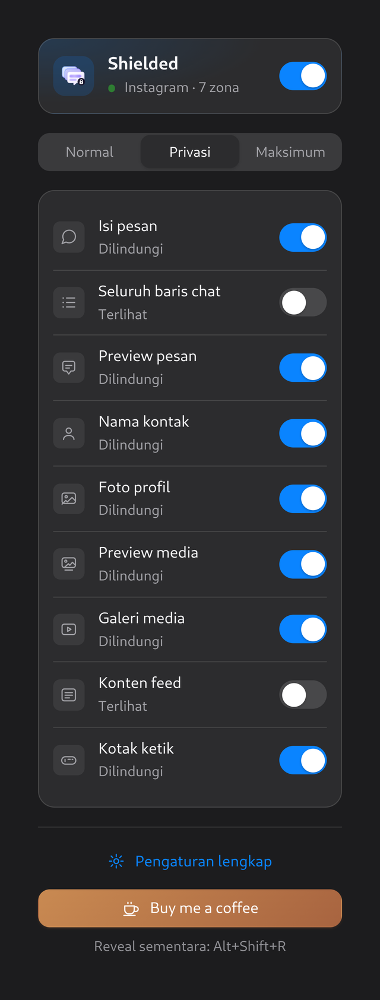
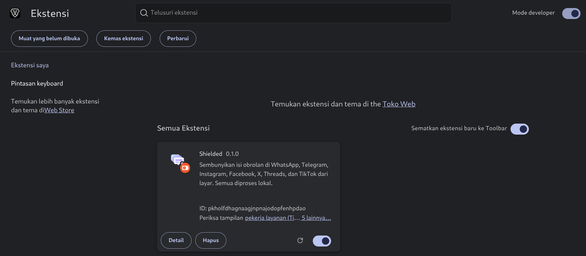
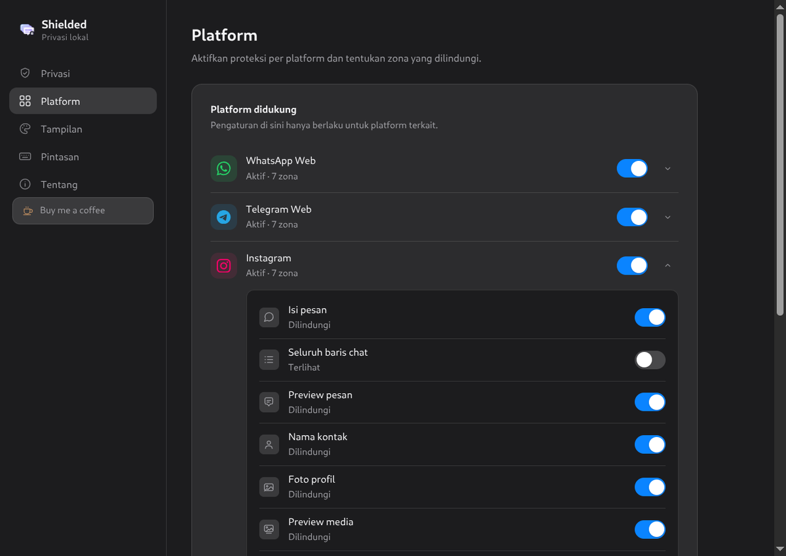
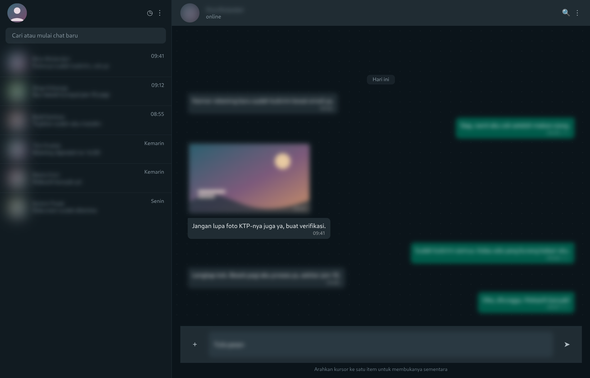

# Shielded

**Privasi visual untuk web chat.** Sembunyikan nama, foto profil, preview pesan, isi percakapan, media, dan kotak ketik dari layar — lalu buka satu per satu saat Anda benar-benar perlu melihatnya.


Shielded bekerja **per item**, bukan memblur seluruh halaman. Nama kontak, avatar, preview, gelembung pesan, dan tombol kirim masing-masing bisa diatur. Saat kursor diarahkan ke satu item, hanya item itu yang terbuka — sisanya tetap terlindungi.

Semua pemrosesan terjadi di perangkat Anda. Tidak ada server, tidak ada akun, tidak ada pengumpulan data.

<br>



---

## Daftar Isi

- [Fitur](#fitur)
- [Platform yang Didukung](#platform-yang-didukung)
- [Instalasi](#instalasi)
- [Tutorial Pemakaian](#tutorial-pemakaian)
- [Zona Perlindungan](#zona-perlindungan)
- [Level Perlindungan](#level-perlindungan)
- [Pintasan Keyboard](#pintasan-keyboard)
- [Dukung Pengembangan](#dukung-pengembangan)
- [Batas Perlindungan](#batas-perlindungan)
- [Privasi dan Izin](#privasi-dan-izin)
- [Pengembangan](#pengembangan)
- [Status Verifikasi](#status-verifikasi)
- [Dokumentasi](#dokumentasi)

---

## Fitur

- **Proteksi per item** — 9 zona independen: isi pesan, baris chat, preview, nama, avatar, preview media, galeri media, konten feed, dan kotak ketik.
- **Hover membuka satu item** — item lain di sekitarnya tetap kabur. Bisa dimatikan bila Anda ingin semua tetap tertutup.
- **Konten feed terpisah** — unggahan di feed Instagram, Facebook, dan Threads tidak ikut terblur kecuali Anda menyalakan zona **Konten feed**.
- **Pengaturan per platform** — aktifkan proteksi hanya di platform yang Anda pakai, lalu atur zonanya sendiri.
- **Tiga level siap pakai** — Normal, Privasi, Maksimum. Berlaku langsung tanpa reload.
- **Ringan** — deteksi ber-throttle 120 ms, pemrosesan idempoten, animasi 120 ms. Tidak ada pemindaian teks pesan.
- **Local-first** — preferensi disimpan di `chrome.storage.local`; nol permintaan jaringan.

---

## Platform yang Didukung

| Platform | Alamat | Status verifikasi live |
|---|---|---|
| WhatsApp Web | `web.whatsapp.com` | Lolos |
| Telegram Web | `web.telegram.org` | Lolos |
| Instagram (feed + DM) | `www.instagram.com` | Lolos |
| Facebook (feed + Messenger) | `www.facebook.com` | Lolos |
| X / Twitter | `x.com`, `twitter.com` | Sebagian (login wall) |
| Threads | `www.threads.net`, `www.threads.com` | Lolos |
| TikTok (pesan) | `www.tiktok.com` | Lolos |

Verifikasi dilakukan 2026-11-10 pada Brave Origin 157 dengan profil uji. X belum bisa diuji penuh karena halaman DM meminta login; selector-nya tetap terpasang dan akan diverifikasi ulang saat tersedia akses.

---

## Instalasi

Shielded dimuat sebagai **unpacked extension** (belum dipublikasikan di Web Store).

### Cara 1 — dari rilis (tanpa Node.js)

1. Unduh `shielded-0.1.0.zip` dari [halaman Releases](https://github.com/Zwart04/Shielded/releases/latest).
2. Ekstrak zip ke folder tetap, misalnya `~/Shielded`.
3. Buka `chrome://extensions` (juga berlaku di Brave, Edge, dan Vivaldi).
4. Nyalakan **Mode developer** di kanan atas.
5. Klik **Muat yang belum dibuka**, lalu pilih folder hasil ekstrak (folder yang berisi `manifest.json`).



6. Sematkan ikon Shielded ke toolbar agar popup mudah dibuka.

### Cara 2 — dari kode sumber

```bash
git clone https://github.com/Zwart04/Shielded.git
cd Shielded
npm install
npm run build
```

Lalu pada langkah 5 di atas, pilih folder **`dist/`**. Setelah mengubah kode, jalankan `npm run build` lagi dan klik **Muat ulang** pada kartu Shielded di `chrome://extensions`.

> Folder `dist/` adalah hasil build. Jangan memilih folder akar proyek — folder itu tidak berisi `manifest.json`.

---

## Tutorial Pemakaian

### 1. Buka popup

Klik ikon Shielded di toolbar. Popup menampilkan platform yang sedang dibuka, status proteksi, dan seluruh zona dalam satu layar.


- **Tombol utama** — menyalakan atau mematikan proteksi untuk platform di tab aktif.
- **Normal / Privasi / Maksimum** — menerapkan preset ke semua zona sekaligus.
- **Daftar zona** — setiap baris punya sakelar sendiri; perubahan langsung terlihat di halaman.
- **Pengaturan lengkap** — membuka dashboard untuk pengaturan per platform, tampilan, dan pintasan.
- **Buy me a coffee** — tautan dukungan (opsional, tidak mengubah fitur).

### 2. Atur per platform di dashboard

Buka **Pengaturan lengkap** → **Platform**. Setiap platform punya sakelar utama dan daftar zona yang bisa dibuka satu per satu.



- Mematikan sebuah platform membuat Shielded tidak menyentuh halaman platform itu sama sekali.
- Zona yang tidak relevan (misalnya **Konten feed** di WhatsApp) tetap tampil, tetapi tidak berdampak.
- **Konten feed** nonaktif secara bawaan: teks dan gambar di feed tetap terlihat. Nyalakan bila Anda ingin unggahan feed ikut dikaburkan.

### 3. Pahami cara kerjanya

Halaman tetap terlihat normal, tetapi setiap item terlindungi sendiri-sendiri:


Arahkan kursor ke satu item — hanya item itu yang terbuka:



> Dua gambar di atas memakai percakapan contoh (DOM sintetis) agar tidak menampilkan data pribadi siapa pun. Tampilan asli tetap memakai antarmuka platform masing-masing.

### 4. Pakai pintasan saat perlu

Tekan `Alt+Shift+R` untuk membuka semua zona selama beberapa detik, atau `Alt+Shift+S` untuk menyalakan/mematikan proteksi. Daftar lengkap ada di [Pintasan Keyboard](#pintasan-keyboard).

---

## Zona Perlindungan

| Zona | Yang disembunyikan | Catatan |
|---|---|---|
| **Isi pesan** | Panel percakapan yang sedang dibuka | Gelembung pesan per item |
| **Seluruh baris chat** | Seluruh baris di daftar chat | Menutup nama, avatar, dan preview sekaligus |
| **Preview pesan** | Teks pesan terakhir di daftar chat | Tetap bisa dibaca setelah baris dibuka |
| **Nama kontak** | Nama di daftar chat dan header | Hover hanya membuka nama yang disorot |
| **Foto profil** | Avatar di daftar dan header | Blur lebih kuat karena area gambar |
| **Preview media** | Gambar dan dokumen kecil di daftar chat | |
| **Galeri media** | Gambar, video, dan dokumen di percakapan | |
| **Konten feed** | Teks dan media unggahan di feed | Nonaktif bawaan; bukan percakapan |
| **Kotak ketik** | Teks yang sedang diketik | Berguna saat berbagi layar |

Zona yang saling bertumpuk tidak digandakan: elemen di dalam item yang sudah terlindungi tidak diproses ulang, sehingga blur tidak menumpuk dan halaman tetap ringan.

---

## Level Perlindungan

| Level | Perilaku |
|---|---|
| **Normal** | Tidak ada yang disembunyikan. |
| **Privasi** | Pesan, preview, nama, avatar, preview media, galeri media, dan kotak ketik dikaburkan. |
| **Maksimum** | Pesan, preview, dan media ditutup; nama dan avatar disembunyikan. Tampilkan lewat hover atau pintasan. |

Preset bisa diubah per zona setelah diterapkan. Pilihan level disimpan per platform, bukan global.

---

## Pintasan Keyboard

| Pintasan | Fungsi | Bisa diubah |
|---|---|---|
| `Alt+Shift+S` | Aktifkan / nonaktifkan perlindungan | `chrome://extensions/shortcuts` |
| `Alt+Shift+R` | Tampilkan semua zona sementara | `chrome://extensions/shortcuts` |
| — | Sembunyikan semua zona segera (panic) | Tetapkan sendiri di `chrome://extensions/shortcuts` |

Chrome tidak mengizinkan ekstensi memetakan ulang pintasan secara programatik. Gunakan halaman pintasan bawaan browser untuk menyesuaikannya.

---

## Dukung Pengembangan

Shielded gratis, tanpa iklan, dan tanpa telemetri. Jika ekstensi ini membantu, Anda bisa mentraktir kopi lewat Tako:

[☕ **Buy me a coffee**](https://tako.id/Zwart04/gift)

Dukungan bersifat opsional dan tidak membuka fitur tambahan. Tautan juga tersedia di popup, sidebar dashboard, dan halaman **Tentang**.

---

## Batas Perlindungan

Shielded adalah **proteksi tampilan visual**, bukan enkripsi. Yang perlu diketahui:

- Tidak melindungi dari **tangkapan layar**, **perekaman layar**, atau **berbagi layar** saat item sedang terbuka.
- Tidak melindungi dari **DevTools**, **pembaca layar**, atau siapa pun yang memegang perangkat Anda.
- Tidak mengubah data di server platform. Pesan tetap tersimpan di layanan masing-masing.
- Hover dan pintasan sengaja membuka item; jangan mengarahkan kursor ke layar yang sedang dibagikan.
- Perubahan DOM platform dapat membuat selector meleset. Perbaikan selector adalah pekerjaan berkelanjutan; lihat [Runbook Selector](docs/selectors-runbook.md).
- Proteksi gagal secara aman: bila selector tidak ditemukan, halaman tetap berjalan normal tanpa diblur.

---

## Privasi dan Izin

| Izin | Alasan |
|---|---|
| `storage` | Menyimpan preferensi secara lokal di perangkat |
| Host permission 7 domain | Menjalankan content script visual di platform yang didukung |
| `commands` | Mendaftarkan pintasan keyboard |

Yang **tidak** diminta: `<all_urls>`, `tabs`, `scripting`, `webRequest`, atau akses jaringan apa pun.

- Tidak ada analitik, ikon pelacak, atau panggilan ke server.
- Preferensi tidak disinkronkan ke cloud.
- Content script hanya membaca struktur DOM untuk menandai elemen; isi pesan tidak dikirim, disimpan, atau dianalisis.

Rincian: [Kebijakan Privasi](docs/privacy-policy.md) dan [Justifikasi Izin](docs/permissions-justification.md). Jalankan `npm run verify:privacy` untuk memeriksa bundle terhadap pola jaringan yang tidak diinginkan.

---

## Pengembangan

### Perintah

```bash
npm install          # pasang dependensi
npm run dev          # build mode watch
npm run build        # build ke dist/
npm run typecheck    # TypeScript (aplikasi + tes)
npm test             # 45 tes unit
npm run verify:privacy  # audit bundle: tidak ada URL jaringan / src=
npm run zip          # paket rilis shielded-0.1.0.zip
```

### Struktur proyek

```
src/
├─ shared/         # tipe, default, ID platform, tautan, pesan runtime
├─ config-store/   # storage + normalisasi skema
├─ core/           # engine, effect renderer, watcher, selector resolver
├─ adapters/       # whatsapp, telegram, instagram, facebook, x, threads, tiktok
├─ content/        # bootstrap content script
├─ background/     # service worker (commands, badge, relay)
└─ ui/             # popup, dashboard, onboarding, privacy, styles
tests/unit/        # pengujian logika murni
tools/             # selector-probe.js (alat manual DevTools)
scripts/           # build, zip, audit privasi
docs/              # perencanaan produk, kebijakan, operasional
```

Arsitektur: engine memantau DOM lewat `MutationObserver` + heartbeat, resolver memilih selector dengan bobot tertinggi, lalu renderer menandai elemen secara idempoten. Tidak ada pemrosesan teks dan tidak ada pekerjaan di main thread yang berjalan terus-menerus.

Detail teknis: [Arsitektur](docs/07-arsitektur-teknis.md) dan [Struktur Proyek](docs/08-struktur-proyek.md).

---

## Status Verifikasi

| Pemeriksaan | Hasil |
|---|---|
| Typecheck | Bersih |
| Tes unit | 45/45 lulus |
| Build produksi | Berhasil |
| Audit privasi | Lolos (5 berkas JS, 19 host permission) |
| Verifikasi selector live | 6 platform lolos, X sebagian |
| Audit manual tampilan | Popup, dashboard, feed, dan DM |

Yang belum tercakup: pengujian otomatis end-to-end pada halaman platform asli (DOM platform berubah-ubah), verifikasi penuh X, dan uji di Firefox/Safari (ekstensi ini khusus Chromium MV3).

Hasil lengkap: [Hasil Verifikasi Selector](docs/selector-verification-results.md).

---

## Dokumentasi

| Dokumen | Isi |
|---|---|
| [Ringkasan Eksekutif](docs/01-ringkasan-eksekutif.md) | Masalah, solusi, cakupan |
| [PRD](docs/04-prd.md) | User story, kebutuhan fungsional |
| [Arsitektur Teknis](docs/07-arsitektur-teknis.md) | Engine, adapter, performa |
| [Design System](docs/09-design-system.md) | Token dan komponen UI |
| [Keamanan, Privasi & Performa](docs/12-keamanan-privasi-performa.md) | Ancaman dan mitigasi |
| [Hasil Verifikasi Selector](docs/selector-verification-results.md) | Status uji per platform |
| [Kebijakan Privasi](docs/privacy-policy.md) | Draf kebijakan privasi |
| [Justifikasi Izin](docs/permissions-justification.md) | Alasan tiap permission |
| [Runbook Selector](docs/selectors-runbook.md) | Prosedur perbaikan selector |

---

## Prinsip

1. **Local-first** — nol permintaan jaringan, nol telemetri.
2. **Tidak menyentuh konten pesan** — hanya struktur DOM dan presentasi.
3. **Least privilege** — `storage` + host permission platform.
4. **Fail-open untuk situs** — proteksi boleh gagal, situs tidak boleh rusak.
5. **Jujur soal batasan** — blur bukan enkripsi.
