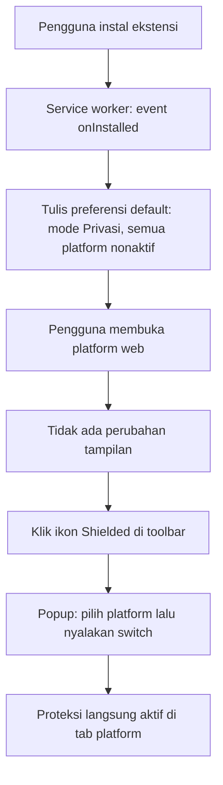
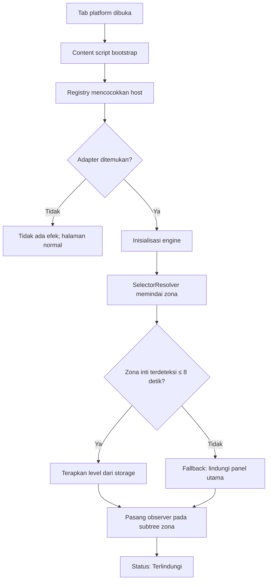
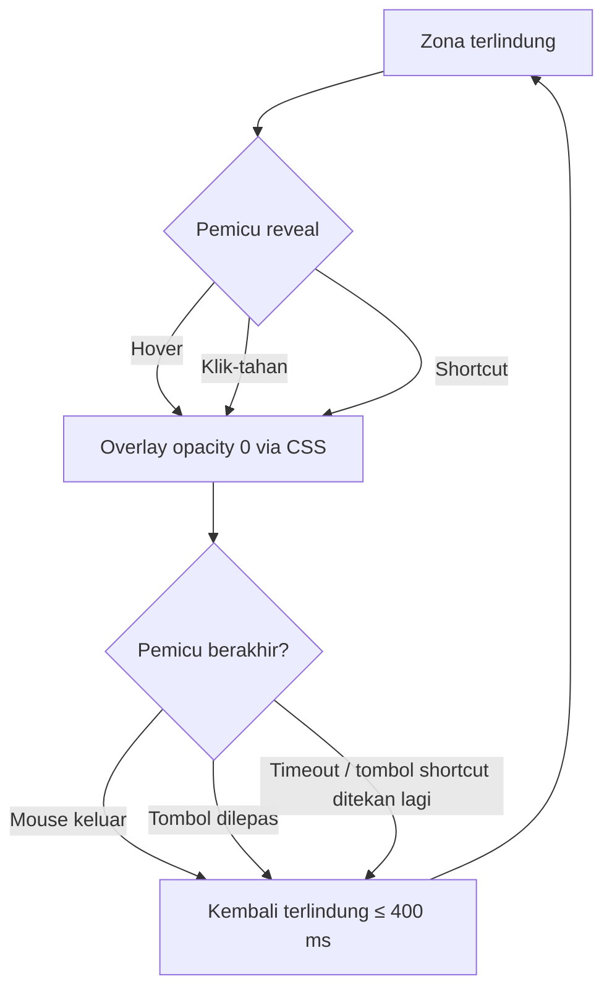
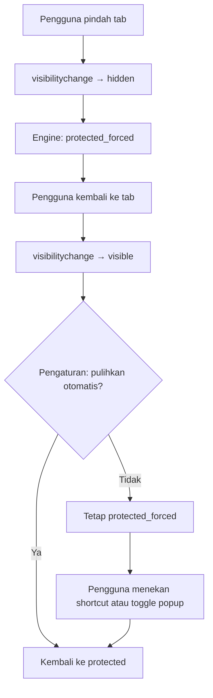
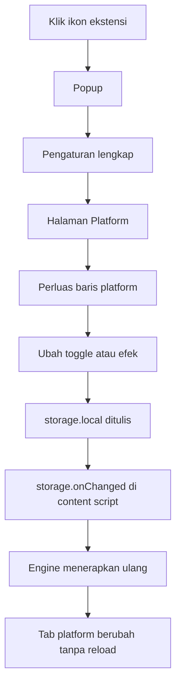
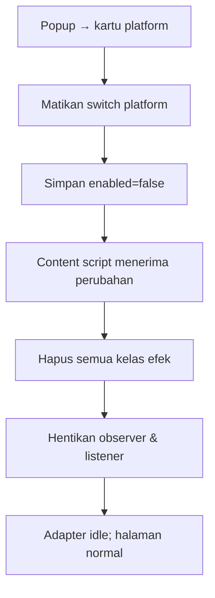
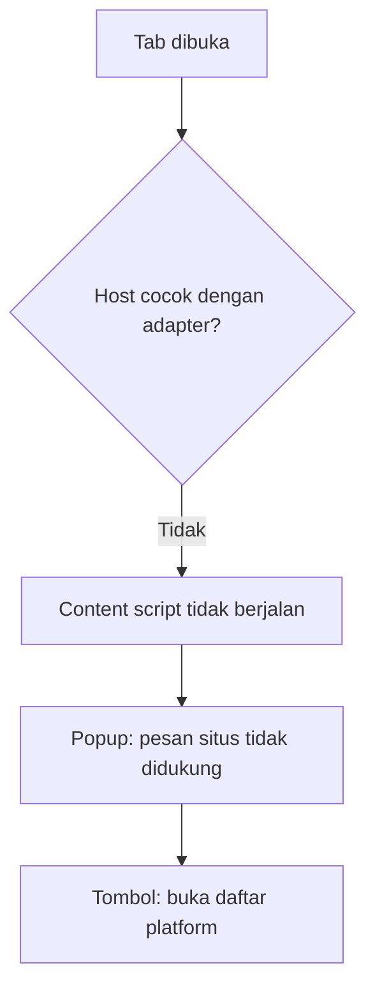
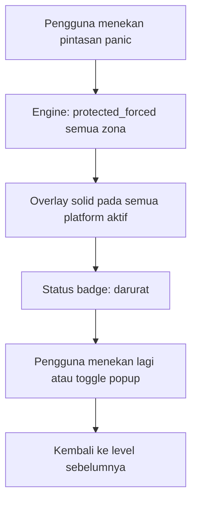

# 11 — Alur Pengguna & Diagram

Semua diagram memakai Mermaid. Setiap langkah dijelaskan setelah diagram.

---

## 11.1 Alur 1 — Instalasi & Pengaturan Awal

**Penjelasan:**
1. `onInstalled` menulis default sekali dan tidak membuka tab apa pun. Jika ini update, migrasi skema dijalankan.
2. Tidak ada onboarding: popup adalah satu-satunya panel pengaturan dan langsung bisa dipakai.
3. Tidak ada permintaan izin tambahan di luar yang sudah dideklarasikan manifest.
4. Karena semua platform nonaktif, instalasi baru tidak mengubah halaman apa pun sampai pengguna menyalakannya.

---

## 11.2 Alur 2 — Deteksi Platform & Proteksi Otomatis

**Penjelasan:**
1. `registry` hanya berisi adapter yang sudah diverifikasi. Tidak ada tebakan.
2. Ambang 8 detik adalah nilai awal yang dapat disesuaikan setelah pengukuran.
3. Fallback memastikan perlindungan terjadi walau selektor tidak presisi.
4. Setelah zona ditemukan, observer dipindahkan ke subtree zona untuk menghemat biaya.

---

## 11.3 Alur 3 — Reveal Sementara

**Penjelasan:**
1. Hover memakai CSS murni (`:hover` pada zona) — tanpa listener per elemen.
2. Klik-tahan memakai `pointerdown`/`pointerup` pada zona.
3. Shortcut mengubah state global sementara di engine, bukan per zona.
4. Fallback timer 2 detik mencegah state "terbuka" tertinggal jika event keluar tidak terpicu.

---

## 11.4 Alur 4 — Pindah Tab & Pemulihan

**Penjelasan:**
1. `visibilitychange` adalah sinyal paling andal untuk tab tersembunyi.
2. `window blur` menangani kasus jendela browser kehilangan fokus tetapi tab masih terlihat.
3. "Tetap terlindung" berguna saat pengguna ingin membaca dokumen lain di samping tanpa membuka chat.
4. Selalu ada jalan keluar satu langkah.

---

## 11.5 Alur 5 — Mengubah Aturan

**Penjelasan:**
1. Tidak ada tombol "Simpan". Perubahan bersifat langsung.
2. `storage.onChanged` dipakai agar semua tab platform yang terbuka ikut memperbarui.
3. Jika tab tidak terbuka, perubahan tetap tersimpan untuk kunjungan berikutnya.

---

## 11.6 Alur 6 — Menonaktifkan Platform

**Penjelasan:**
1. Menonaktifkan harus benar-benar menghentikan pekerjaan, bukan hanya menyembunyikan efek.
2. Observer dan listener dilepas untuk menghemat CPU.
3. Mengaktifkan kembali menjalankan ulang deteksi dari awal.

---

## 11.7 Alur 7 — Platform Tidak Dikenali

**Penjelasan:**
1. Content script tidak dijalankan di luar 7 domain (least privilege).
2. Popup tetap dapat dibuka dan memberikan penjelasan, bukan error.

---

## 11.8 Alur 8 — Panic Blur (P1)

**Penjelasan:**
1. Panic tidak mengubah preferensi permanen.
2. Hanya berlaku pada tab platform yang aktif agar tidak mengunci seluruh browser.
